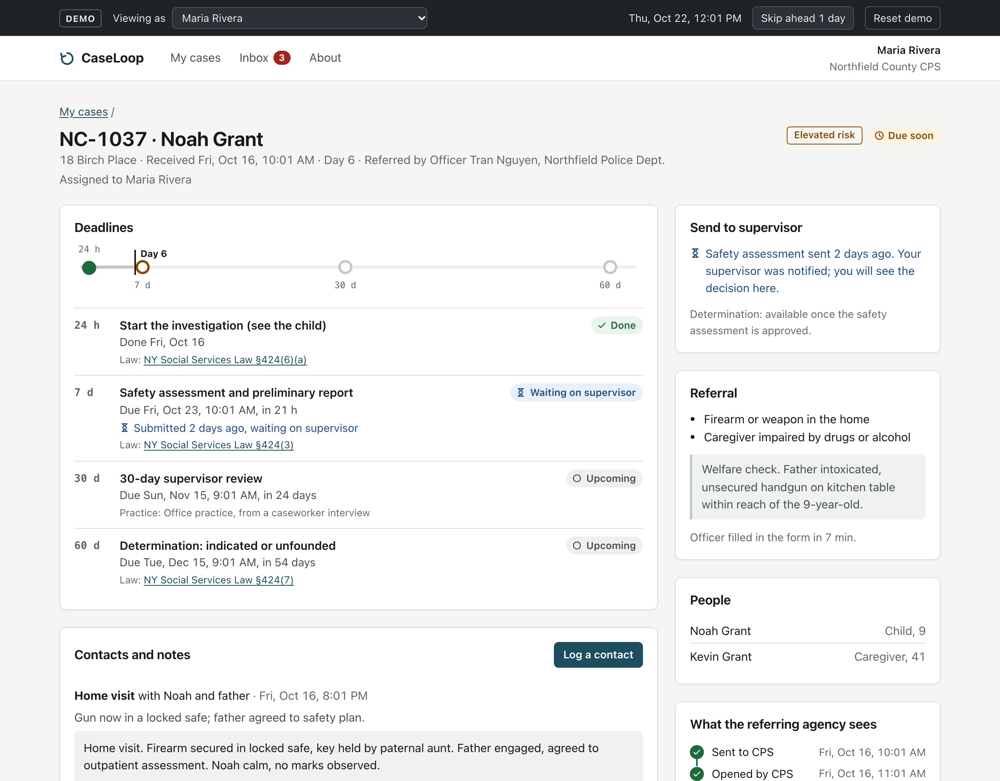
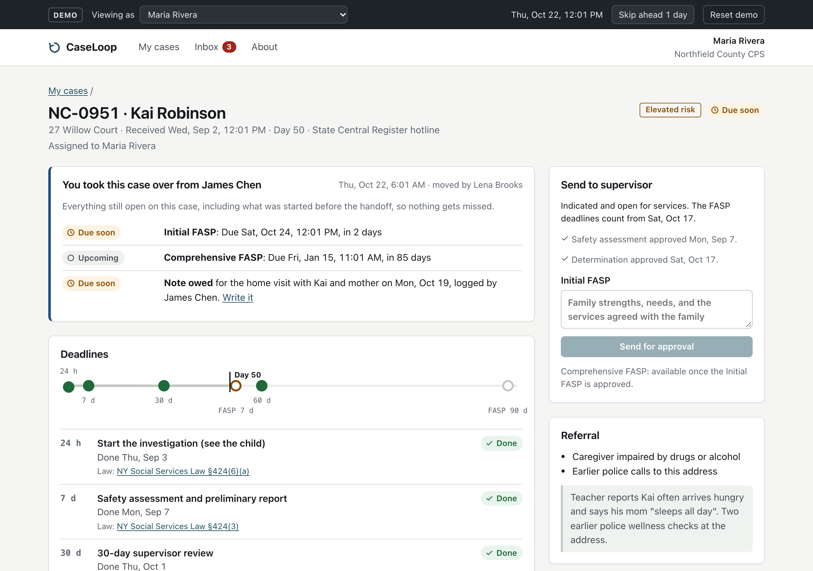
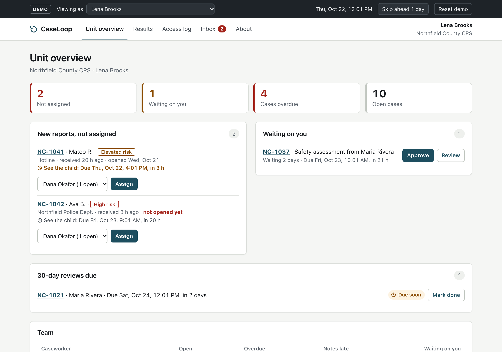
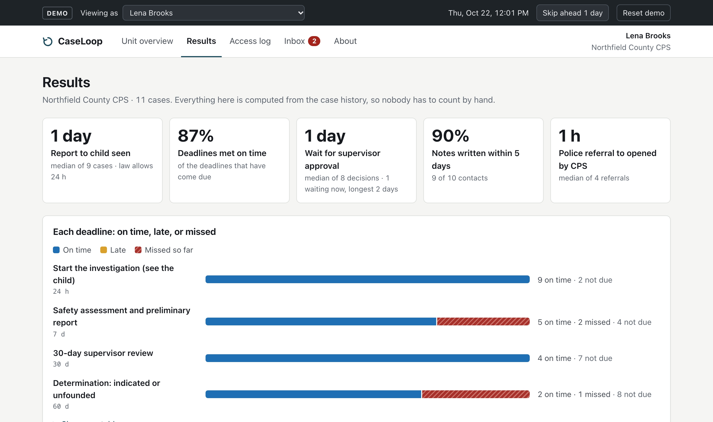
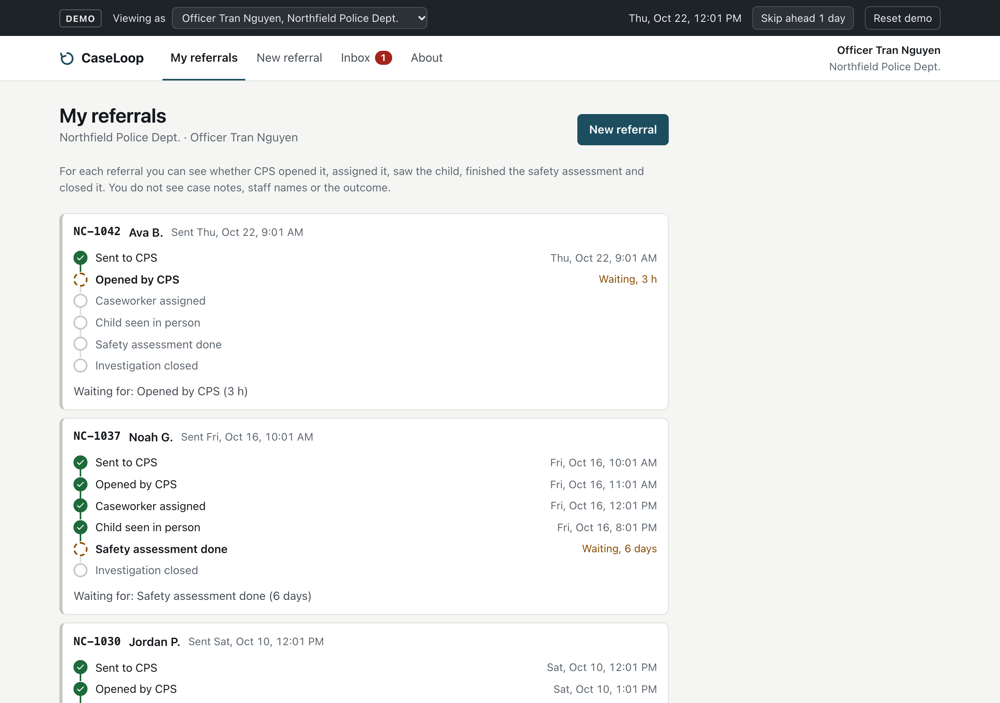
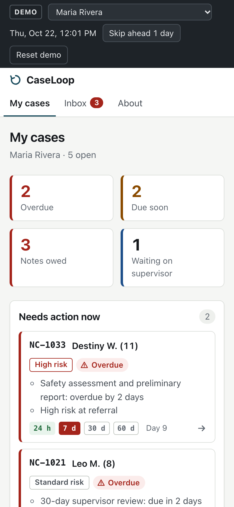

# CaseLoop

**Closed-loop child-protection referrals: from a police report to a CPS determination, with every deadline, handoff and approval visible to the people who need it, and nothing more.**

**Live demo: https://sinchi5.github.io/caseloop/** · made-up data, runs entirely in your browser



**New, from caseworker feedback:** when a case changes hands, the new worker sees everything still open, including FASP deadlines once a case is indicated.



## Why this exists

My cousin is a CPS caseworker in New York. I asked him how a case actually moves, from the State Central Register report to the day it closes, and where things fall through the cracks. He described seven problems. CaseLoop is a working answer to each of them, plus the one that sits between agencies: the officer who made the report never learns whether anyone acted on it.

| What goes wrong today | What CaseLoop does |
|---|---|
| A submission to a supervisor sends no notification. “I never saw it” has no answer. | Submissions show as *waiting on supervisor* on both sides with a running timer. Returns come back with a reason. Every step is in an append-only history. |
| The 7-day safety check and 30-day midpoint are tracked by hand; a case can reach day 90 unnoticed. | Every deadline is computed from intake, cites its source (law or office practice), and turns *due soon* then *overdue* by itself. |
| Cases are worked in the order received. Nothing is marked urgent. | Lists are ordered by missed deadline, then risk, then next due date, and each case says why it is where it is. |
| People with history show up as new, or get merged wrongly. | Possible earlier records are scored on name, birth date and address with the reasons shown. A worker confirms; nothing merges on its own. |
| Notes due in 3–5 days slip to 3–4 weeks. | A visit is logged from a phone in under a minute; the note gets its own 5-day clock and a *Notes owed* list. |
| Attaching a photo takes four steps in two places. | Photos attach to the contact in the same step, from the camera. |
| Workers keep private lists of due dates. | The list is the system. |
| The referring officer never hears back. | The officer sees *opened, assigned, child seen, assessed, closed* with times, and never the notes, staff names or outcome. |
| A worker inherits a case and doesn't know what the last worker left due. *Added the day after the caseworker tried the first version: he had just inherited a case with a FASP due that nobody told him about.* | When a case changes hands, the new worker gets an inbox message and a handoff panel listing everything still open: deadlines (including the Initial FASP, 7 days from indication, and the Comprehensive FASP, 90 days), notes the previous worker never typed up, and returned work. Indicated cases now stay open for services instead of closing. |
| Nobody is told anything; people have to go look. | Each person has an inbox: assigned to you, sent to you, approved, returned (with the reason), deadline coming, referral not opened. Every notice is derived from the case history and the clock, so it can't fall out of sync. |
| Nobody can say whether things are getting better. | A results page measures report-to-visit time, deadlines met, approval waits and note lag from the same history, with no extra data entry. |

## A three-minute tour

1. **Officer Tran Nguyen**: send a referral. NC-1042 from tonight still says *waiting for: opened by CPS*.
2. **Lena Brooks (supervisor)**: assign the new report; approve the safety assessment that has waited two days.
3. **Maria Rivera (caseworker)**: her cases are in order of what's late. Open the new one and log a home visit.
4. **Officer Nguyen** again: the loop now shows opened, assigned, child seen.
5. **Skip ahead 1 day** in the demo bar and watch the deadlines move and the **Inbox** fill up. As Lena, open **Results** and the **Access log**.

| Supervisor | Results | Officer | Phone |
|---|---|---|---|
|  |  |  |  |

## How it's built

```
 events (append-only log)          src/domain/types.ts       Zod schemas; also validate saved state on load
        │
        ▼
 deriveCases()                     src/domain/caseState.ts   each case rebuilt from its events; invalid transitions ignored
        │
        ├── computeClocks()        src/domain/clocks.ts      deadlines from NY SSL §424, each with its source
        ├── rankCases()            src/domain/priority.ts    missed deadline > risk > next due, with reasons
        ├── findMatches()          src/domain/matching.ts    Jaro-Winkler + birth-date + address rules, explained
        ├── accessTo() / agencyView()  src/domain/policy.ts  who sees what; the officer's view is built field by field
        ├── noticesFor()           src/domain/notifications.ts  each person's inbox, derived from events + clock
        ├── latestHandoff()        src/domain/handoff.ts     what a worker inherits when a case changes hands
        └── results()              src/domain/metrics.ts     report-to-visit, deadlines met, approval waits, note lag
        │
        ▼
 React UI                          src/ui/*                  role-specific screens; every case view is access-logged
```

The domain layer is plain TypeScript with no React, so every rule is unit-tested on its own. Design decisions and trade-offs are in **[docs/DESIGN.md](docs/DESIGN.md)**; what is tested and how a caseworker validates it is in **[docs/TEST-PLAN.md](docs/TEST-PLAN.md)**.

**Stack:** TypeScript, React 19, React Router, Zod, Vite · Vitest, Playwright, axe-core · GitHub Actions → GitHub Pages.

## Run it

```bash
npm ci
npm run dev          # http://localhost:5173
npm test             # domain unit tests (Vitest)
npm run test:e2e     # browser flows, accessibility, phone layout (Playwright)
npm run typecheck && npm run lint
```

Every push to `main` runs all of the above in CI before deploying.

## What this is not

- Not a real system. Every person, case and place is invented; nothing leaves the browser (state lives in `localStorage`, photos only in memory).
- The risk checklist is illustrative, not a validated screening instrument.
- There is no sign-in; the demo bar switches between people so you can see each side.
- Not affiliated with any agency or company.

Built by [Anthony Sinchi](https://github.com/Sinchi5), University at Buffalo, CS ’26.
